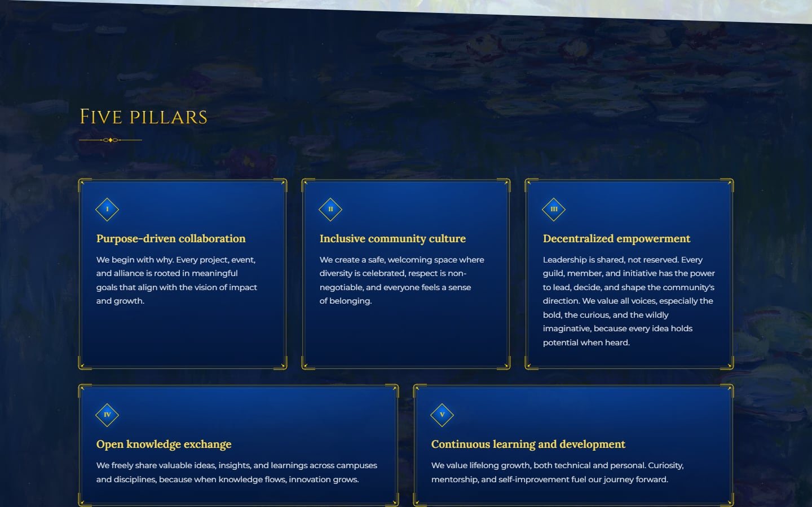
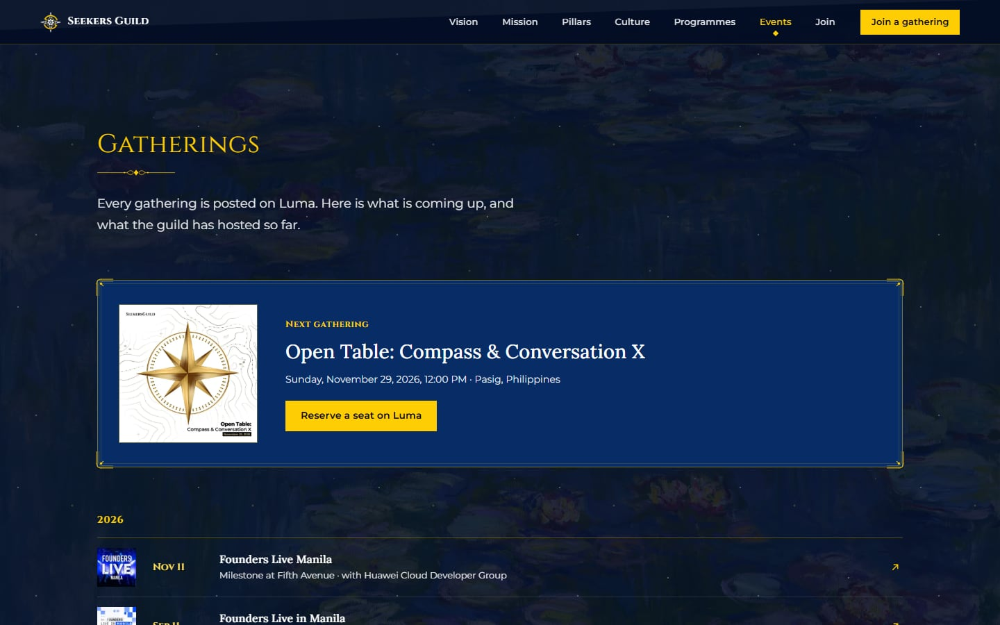

<h1 align="center">
  <picture>
    <source media="(prefers-color-scheme: dark)" srcset="https://raw.githubusercontent.com/seekersguild/SG-Website/main/docs/assets/brand/lockup-dark.svg">
    
  </picture>
</h1>

<p align="center">
  The official website of Seekers Guild. We seek those who seek.
</p>

<p align="center">
  <a href="LICENSE"></a>
  <a href="package.json"></a>
  <a href="package.json"></a>
  <a href="tsconfig.json"></a>
  <a href=".node-version"></a>
</p>

Seekers Guild is a decentralized, student-led community in the Philippines, founded in April 2025. It connects curious and driven students, especially from the provinces, to people, projects, and opportunities beyond the classroom. This repository contains the guild's public website.

## Features

- **The guild:** Its vision, mission, five pillars, culture, and the people it serves.
- **Programmes and gatherings:** Ways to build, learn, meet, and contribute, with upcoming events sourced from Luma when available.
- **Get involved:** Paths for new members, collaborators, and prospective partners.
- **Design:** Guild sapphire and gold layered over paintings, with responsive layouts and reduced-motion support.
- **Discovery:** Metadata, structured data, sitemap, and link previews.

`main` is the current stable production baseline. Some content and improvements are still missing there; the multi-page work has been merged into `dev`, where further fixes and QA are still needed. The [open issues](https://github.com/seekersguild/SG-Website/issues) track unfinished work. A feature on `dev` is not live until it is released and verified on the public site.

## Screenshots

These are captures of the **stable `main` site**. Click an image to open it. They are a production reference, not a preview of the newer `dev` layout; visual PRs should include fresh screenshots of their own changes.

| Opening | Five pillars |
| --- | --- |
| [](https://github.com/seekersguild/SG-Website/blob/main/docs/assets/screenshots/home.jpg) | [](https://github.com/seekersguild/SG-Website/blob/main/docs/assets/screenshots/pillars.jpg) |
| **Gatherings** | **On a phone** |
| [](https://github.com/seekersguild/SG-Website/blob/main/docs/assets/screenshots/events.jpg) | [](https://github.com/seekersguild/SG-Website/blob/main/docs/assets/screenshots/phone.jpg) |

## Getting started

Requirements: Node.js 22 (see `.node-version`), npm, and Git.

```sh
git clone https://github.com/seekersguild/SG-Website.git
cd SG-Website
git fetch origin
git switch --track origin/dev
npm install
npm run dev
```

Open <http://localhost:3000>. The clone starts on `main`; switch to `dev` to work against the current integration branch. For a production check, run `npm run build` and then `npm run start`. On Windows PowerShell, use `npm.cmd` if the execution policy blocks `npm.ps1`.

### Editing the content

The site keeps most copy and event data under `app/content/`. Check the branch you are editing: the stable `main` and newer `dev` have different page layouts. Update the relevant content source instead of duplicating claims in components. Verify event dates and partner claims against their source before publishing.

### Deploying

The site deploys as a Next.js app. `NEXT_PUBLIC_SITE_URL` sets the public address for generated metadata, link previews, and the sitemap; the hosting provider may supply a production domain automatically. A GitHub Release tag does not itself deploy the site.

## Development

Start each new task from the latest `dev`, then make a focused branch and open a PR back into `dev`:

```sh
git fetch origin
git switch dev                 # first checkout: git switch --track origin/dev
git pull --ff-only origin dev
git switch -c feat/short-task-name
```

Use `fix/short-task-name` for fixes. Link the issue in the PR, include before/after screenshots for visual changes, and resolve QA findings on the work branch. Do not push site changes directly to `main`. The team should promote `dev` through a reviewed PR only when it is stable and ready for production; verify the deployed site afterward.

| Command | What it does |
| --- | --- |
| `npm run dev` | Local development server on port 3000 |
| `npm run lint` | TypeScript check |
| `npm run build` | Production build |
| `npm run start` | Serve the production build |
| `npm run smoke` | On `dev`, check routes, headings, and internal links while a local server runs |
| `npm run release:notes` | Preview release notes |

Releases are tagged from a clean, approved `main` after the reviewed promotion from `dev`.

### UI/UX QA handoff

Review the running `dev` build on phone, tablet, laptop, and wide desktop. Check hierarchy, spacing, backgrounds, overflow, fixed bars, navigation, touch and keyboard use, focus states, and reduced motion. Check both upcoming-event and no-upcoming-event states, and confirm dates, links, claims, and contact details against their sources. Run lint, build, and the smoke check; inspect affected routes in a browser.

For each finding, record the route, viewport, steps to reproduce, expected behavior, and a screenshot in an issue. Keep an issue open until its acceptance criteria are met on the integration branch, then verify again after release.

Project layout varies by branch. On `dev`, page routes live in `app/`, shared interactions in `app/components/`, content in `app/content/`, and styles in `app/styles/` and `app/globals.css`. Inspect the current branch before editing.

## Documentation

- [Website playbook on `dev`](https://github.com/seekersguild/SG-Website/blob/dev/docs/PLAYBOOK.md) — durable content, design, evidence, documentation, and release decisions.
- [GitHub issues](https://github.com/seekersguild/SG-Website/issues) — outstanding work and QA findings.

## License

[MIT](LICENSE). The Seekers Guild name and logo are the guild's own marks and are not covered by the code license.
