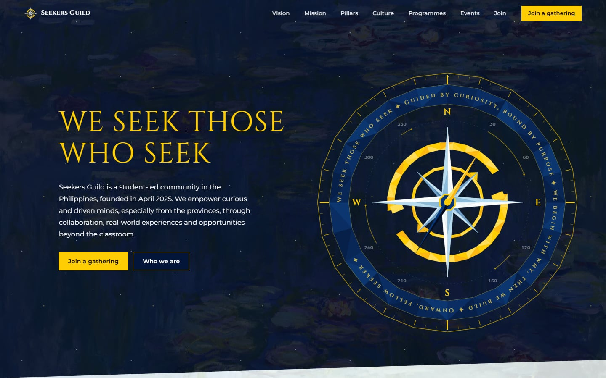
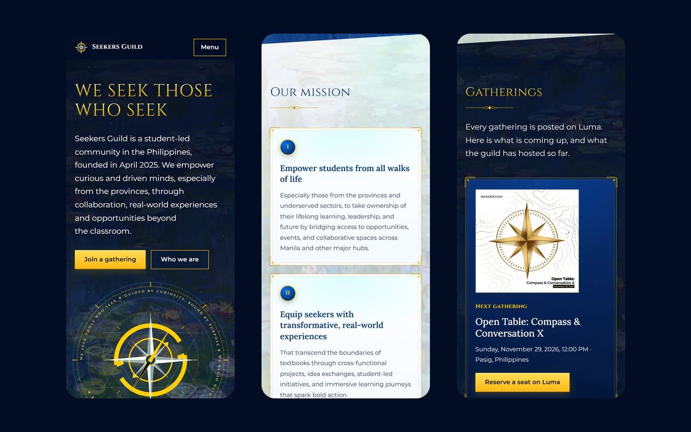

# Seekers Guild website

Seekers Guild is a student-led community in the Philippines for curious and driven minds, especially from the provinces. This repository contains its Next.js website.

## Branches and release status

| Branch | Purpose |
| --- | --- |
| `main` | Current stable production baseline. It is usable, but [open issues](https://github.com/seekersguild/SG-Website/issues) still track missing content and improvements. |
| `dev` | Shared integration and UI/UX QA branch. It contains the merged multi-page work and still needs review and fixes before production. |
| `feat/*`, `fix/*` | Focused work branches created from the latest `dev`; reviewed back into `dev`. |

**As of 27 November 2026**, the multi-page `feat/new-pages` work has been merged into `dev`. This does not mean it has been released to `main` or deployed. Check the actual branch and public site before reporting a feature as live.

Do not push directly to `main` for site changes. Keep it on the stable version until `dev` passes development and UI/UX QA, release-blocking issues are resolved, and the team agrees it is production-ready. Promote `dev` through a reviewed PR, then verify the deployed site.

## Developer workflow

Use Node.js 22 (see `.node-version`) and npm. Start new work from the current remote `dev`:

```sh
git fetch origin
git switch dev                 # first checkout: git switch --track origin/dev
git pull --ff-only origin dev
git switch -c feat/short-task-name
npm install
npm run dev
```

Open <http://localhost:3000>. Use `fix/short-task-name` for a fix. Make a focused change, run the relevant checks, and open a PR into `dev` with its issue linked. Add before/after screenshots for visual changes. On Windows PowerShell, use `npm.cmd` if the execution policy blocks `npm.ps1`.

| Command | Check |
| --- | --- |
| `npm run lint` | TypeScript check |
| `npm run build` | Production build |
| `npm run start` | Serve the built site locally |
| `npm run smoke` | On `dev`, with a local server running: routes, headings, and internal links |

`NEXT_PUBLIC_SITE_URL` sets the public URL used for generated metadata and sitemap. Tag releases from a clean, approved `main` after promotion; a GitHub Release tag alone does not deploy the site.

## UI/UX QA

Review the running `dev` build at phone, tablet, laptop, and wide desktop widths. Check text hierarchy and spacing, sharp backgrounds, horizontal overflow, fixed elements, navigation, forms, links, keyboard focus, touch targets, and reduced motion. Verify current event details against Luma and inspect both upcoming-event and no-upcoming-event states. Check copy, claims, partner names, and contact details against confirmed sources.

Record each finding with a route, viewport, reproduction, expected behavior, and screenshot. Keep unresolved work in [GitHub issues](https://github.com/seekersguild/SG-Website/issues); a partial feature-branch implementation is not grounds to close an issue. Run the checks above and verify affected routes in a browser before merging. Verify the public site again after release.

## Screenshots

These images are the **stable `main` production-build reference**, not previews of the current `dev` UI. Attach fresh screenshots to visual PRs so reviewers can assess the version being proposed.

| Opening | Five pillars |
| --- | --- |
| [](https://github.com/seekersguild/SG-Website/blob/main/docs/assets/screenshots/home.jpg) | [](https://github.com/seekersguild/SG-Website/blob/main/docs/assets/screenshots/pillars.jpg) |
| **Gatherings** | **Phone** |
| [](https://github.com/seekersguild/SG-Website/blob/main/docs/assets/screenshots/events.jpg) | [](https://github.com/seekersguild/SG-Website/blob/main/docs/assets/screenshots/phone.jpg) |

## Project guidance

The [website playbook on `dev`](https://github.com/seekersguild/SG-Website/blob/dev/docs/PLAYBOOK.md) holds durable content, design, evidence, documentation, and release decisions. Put unfinished work in issues and changing site facts in the code on the branch being edited. The older `main` and newer `dev` layouts differ, so inspect that branch before editing or following a file path from another branch.

## License

[MIT](LICENSE). The Seekers Guild name and logo are the guild's own marks and are not covered by the code license.
